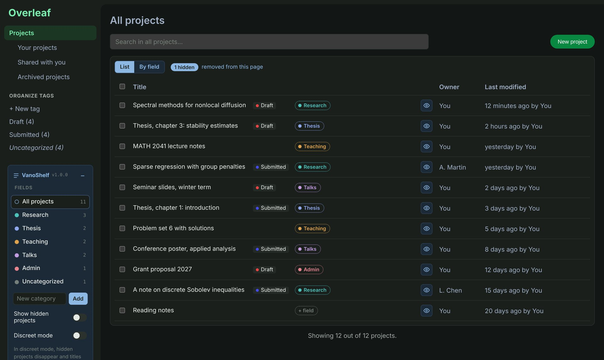
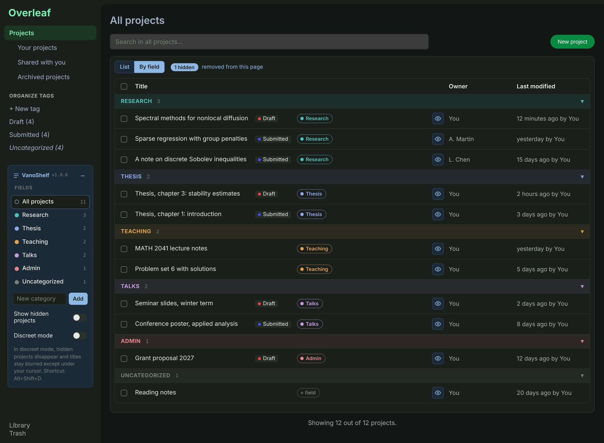
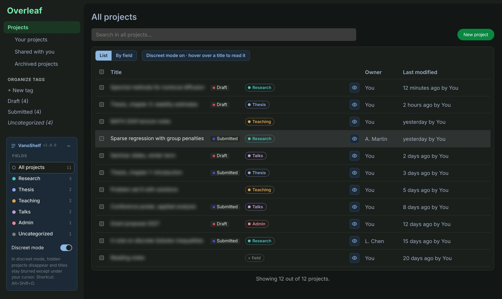
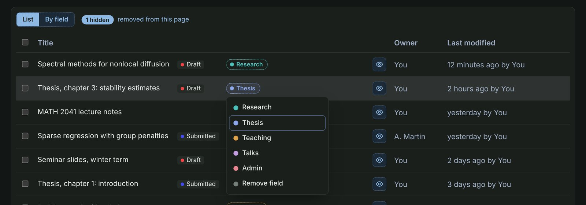
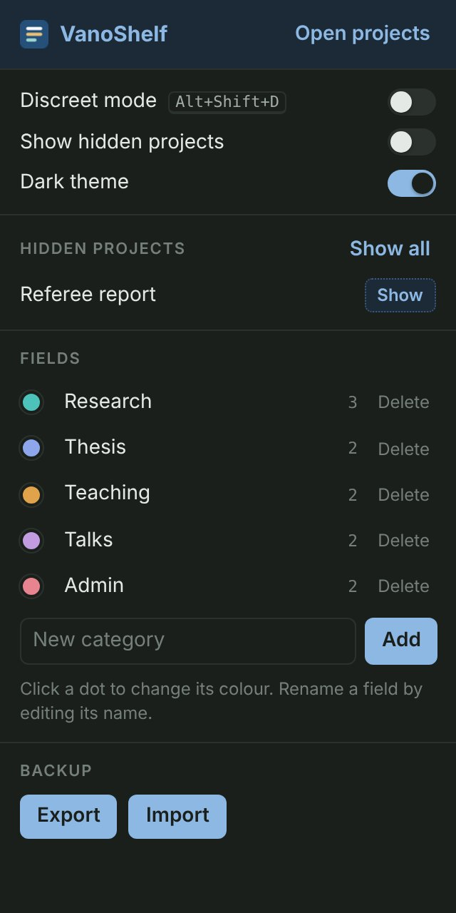

<h1 align="center">VanoShelf pour Overleaf</h1>

<b>Mettez de l'ordre dans vos projets Overleaf.</b> 
Classez vos projets par domaine, masquez ceux que vous ne voulez pas voir à l'écran et floutez tous les titres quand quelqu'un regarde.

 

<a href="README.md">English version</a>

---

## Pourquoi VanoShelf

Overleaf affiche tous les projets dans une seule longue liste. Articles, chapitres de thèse, notes de cours, présentations et rapports d'arbitrage sont mélangés, et toute personne qui jette un œil à votre écran les voit tous. VanoShelf ajoute ce qui manque à la page des projets.

- **Domaines.** Créez vos propres catégories (Recherche, Thèse, Enseignement, Exposés, ou autre) et attribuez-en une à chaque projet d'un clic sur sa pastille. Un bloc dans la colonne de gauche indique combien de projets contient chaque domaine et filtre la liste en un clic.
- **Colonnes nettes.** Titre, étiquettes Overleaf et domaine sont alignés dans les mêmes colonnes sur chaque ligne.
- **Vue par domaine.** La liste se regroupe en sections repliables, une par domaine.
- **Masquer des projets.** Le bouton œil retire un projet de la liste. Les projets masqués peuvent être réaffichés en hachuré, ou restaurés depuis la fenêtre de l'icône.
- **Mode discret.** Appuyez sur `Alt+Shift+D` : les projets masqués disparaissent complètement et tous les titres sont floutés tant que la souris n'est pas dessus. Pratique dans un bureau partagé, en réunion ou au projecteur.
- **Modes jour et nuit.** Toute la page des projets passe en sombre. Le bouton soleil/lune en haut du panneau bascule entre nuit et jour.
- **Sauvegarde.** Exportez vos domaines et projets masqués dans un fichier, et importez-les sur un autre ordinateur.
- **Privé.** Tout reste dans votre navigateur. VanoShelf n'envoie rien à Overleaf ni ailleurs, et ne modifie jamais vos projets. Pas de compte, pas de suivi, pas de serveur.
- **Libre et gratuit** (MIT).

## Captures d'écran

| | |
|---|---|
|  **Par domaine** : une section repliable par domaine. |  **Mode discret** : les titres restent flous sauf sous la souris. |
|  **Choisir un domaine** : cliquez sur la pastille du projet. |  **Fenêtre de l'icône** : renommer les domaines, réafficher, sauvegarder. |

Les projets visibles sur ces captures sont des exemples inventés.

## Installation

VanoShelf fonctionne dans **Google Chrome, Microsoft Edge, Brave, Arc, Vivaldi et Opera**, sur **macOS, Windows et Linux**.

1. **Téléchargez** ce dépôt : bouton vert **Code** → **Download ZIP**, puis décompressez-le.
   - macOS : double-cliquez sur le zip dans le Finder.
   - Windows : clic droit sur le zip → **Extraire tout…**
2. **Ouvrez la page des extensions** de votre navigateur :
   - Chrome, Brave, Arc, Vivaldi : tapez `chrome://extensions` dans la barre d'adresse
   - Edge : tapez `edge://extensions`
3. Activez le **Mode développeur** (en haut à droite dans Chrome, à gauche dans Edge).
4. Cliquez sur **Charger l'extension non empaquetée** et choisissez le dossier **`extension`** (celui qui contient `manifest.json`).
5. Ouvrez ou rechargez [overleaf.com/project](https://www.overleaf.com/project).

Le bloc VanoShelf apparaît dans la colonne de gauche, sous les étiquettes d'Overleaf. Épinglez l'extension dans la barre d'outils (icône puzzle → épingle) pour accéder à sa fenêtre.

**Pour mettre à jour**, téléchargez la nouvelle version, remplacez le dossier, puis cliquez sur ↻ **Recharger** sur la carte VanoShelf dans `chrome://extensions` et rechargez Overleaf. Le numéro de version s'affiche à côté de « VanoShelf » dans le bloc. Vos domaines et projets masqués sont conservés.

## Utilisation

| Action | Comment |
|---|---|
| Filtrer par domaine | Cliquez sur un domaine dans le bloc VanoShelf |
| Donner un domaine à un projet | Cliquez sur sa pastille (ou **+ field**) et choisissez |
| Nouveau domaine | Tapez un nom sous la liste et cliquez sur **Add** |
| Renommer, recolorer ou supprimer | **Edit** à côté de « Fields » dans le panneau (ou fenêtre de l'icône) |
| Masquer ou afficher un projet | Bouton œil en fin de ligne |
| Regrouper par domaine | **By field** au-dessus de la liste |
| Mode discret | `Alt+Shift+D`, ou l'interrupteur du bloc ou de la fenêtre |

Le raccourci se change dans `chrome://extensions/shortcuts`.

## À savoir

- Masquer un projet le retire seulement de **votre** affichage dans **ce** navigateur. Le projet reste dans votre compte Overleaf, et quiconque ouvre votre compte ailleurs le voit.
- Les domaines et projets masqués sont enregistrés dans le stockage local du navigateur. Utilisez **Export** pour en garder une copie ou les transférer.
- VanoShelf ne s'exécute que sur la page des projets (`overleaf.com/project`). L'éditeur n'est pas touché.

## Auteur

VanoShelf est écrit et maintenu par **Yassine Ait Mohamed**, doctorant en mathématiques à l'Université de Sherbrooke. C'est d'abord un outil pour mes propres projets Overleaf, partagé dans l'espoir qu'il serve à d'autres.

- Site : [yassine-aitmohamed.github.io](https://yassine-aitmohamed.github.io)
- Bugs et idées : [ouvrir une issue](https://github.com/yassine-aitmohamed/vanoshelf-extension/issues)
- Du même auteur : [VanoLib Reader](https://github.com/yassine-aitmohamed/vanolib-extension), un lecteur PDF pour les articles.

VanoShelf n'est pas affilié à Overleaf.

## Licence

MIT. Voir [LICENSE](LICENSE).
