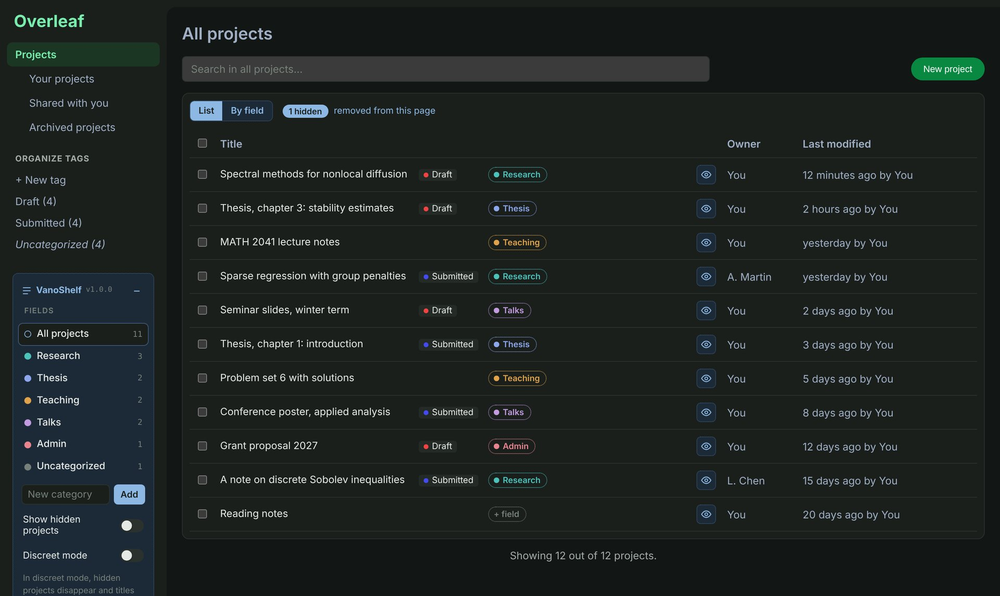
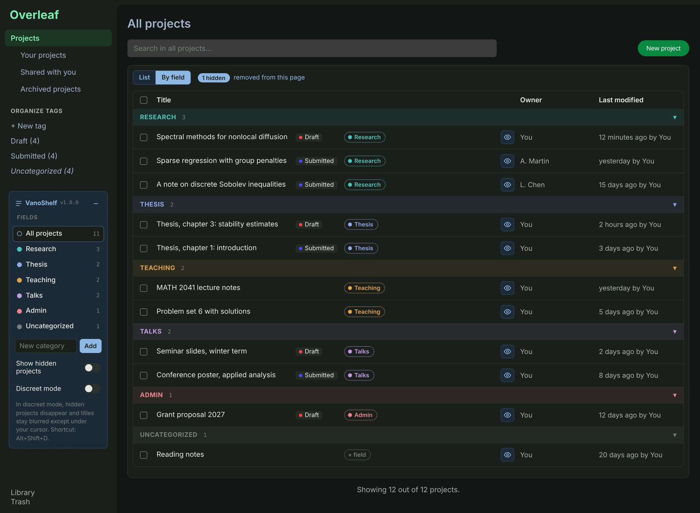
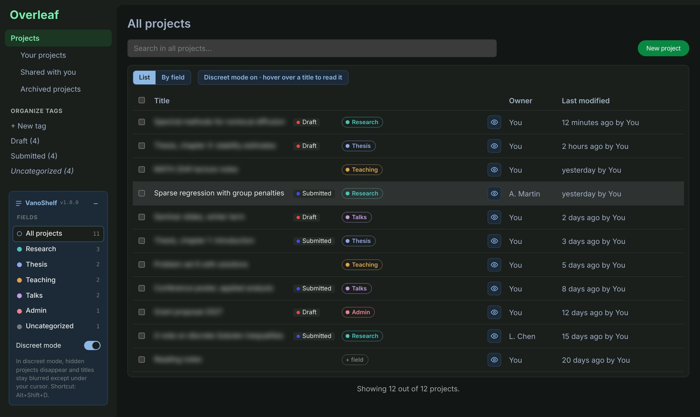
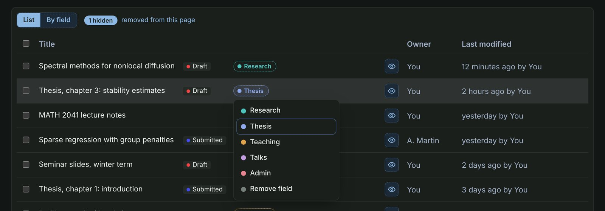
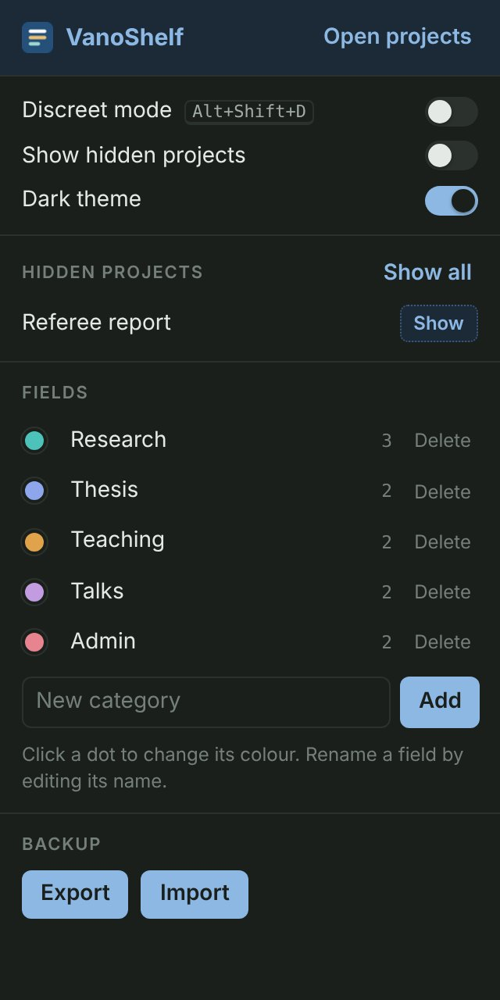

<h1 align="center">VanoShelf for Overleaf</h1>

<b>Put order in your Overleaf projects.</b> 
Sort projects into fields, hide the ones you do not want on screen, and blur every title when someone is looking.

  

<a href="README.fr.md">Version française</a>

---

## Why VanoShelf

Overleaf shows every project in one long list. Papers, thesis chapters, lecture notes, slides and referee reports all sit together, and anyone who glances at your screen sees all of them. VanoShelf adds what the projects page is missing.

- **Fields.** Create your own categories (Research, Thesis, Teaching, Talks, or anything else) and give each project one with a single click on its chip. A panel in the left column shows how many projects each field holds and filters the list in one click.
- **Clean columns.** Title, Overleaf tags and field line up in the same columns on every row, so the list reads at a glance.
- **By field view.** Group the list into collapsible sections, one per field.
- **Hide projects.** The eye button removes a project from the list. Hidden projects can be shown again, hatched, or brought back from the toolbar popup.
- **Discreet mode.** Press `Alt+Shift+D`: hidden projects disappear completely and every title is blurred until your cursor is on it. Useful in a shared office, a meeting or on a projector.
- **Day and night modes.** The whole projects page turns dark, with colours chosen for long sessions. The sun/moon button in the panel header switches between night and day.
- **Backup.** Export your fields and hidden projects to a file, and import them on another computer.
- **Private.** Everything stays in your browser. VanoShelf sends nothing to Overleaf or anywhere else, and never changes your projects. No account, no tracking, no server.
- **Free and open source** (MIT).

## Screenshots

| | |
|---|---|
|  **By field**: one collapsible section per field. |  **Discreet mode**: titles stay blurred until the cursor is on them. |
|  **Choosing a field**: click a project's chip. |  **Popup**: rename fields, show hidden projects, backup. |

The projects in these screenshots are invented examples.

## Install

VanoShelf works in **Google Chrome, Microsoft Edge, Brave, Arc, Vivaldi and Opera**, on **macOS, Windows and Linux**.

1. **Download** this repository: green **Code** button → **Download ZIP**, then unzip it.
   - macOS: double-click the zip in Finder.
   - Windows: right-click the zip → **Extract All…**
2. **Open the extensions page** of your browser:
   - Chrome, Brave, Arc, Vivaldi: type `chrome://extensions` in the address bar
   - Edge: type `edge://extensions`
3. Turn on **Developer mode** (top right in Chrome, left side in Edge).
4. Click **Load unpacked** and choose the **`extension`** folder (the one that contains `manifest.json`).
5. Open or reload [overleaf.com/project](https://www.overleaf.com/project).

The VanoShelf panel appears in the left column, under Overleaf's tags. Pin the extension to the toolbar (puzzle icon → pin) to reach the popup.

**To update**, download the new version, replace the folder, then click ↻ **Reload** on the VanoShelf card in `chrome://extensions` and reload Overleaf. The version number is shown next to "VanoShelf" in the panel, so you can check which one is running. Your fields and hidden projects are kept.

## Use

| Action | How |
|---|---|
| Filter by field | Click a field in the VanoShelf panel |
| Give a project a field | Click its chip (or **+ field**) and pick one |
| New field | Type a name under the field list and press **Add** |
| Rename, recolour or delete a field | **Edit** next to "Fields" in the panel (or the toolbar popup) |
| Hide or show a project | Eye button at the end of the row |
| Group by field | **By field** above the list |
| Discreet mode | `Alt+Shift+D`, or the switch in the panel or popup |

The shortcut can be changed at `chrome://extensions/shortcuts`.

## Good to know

- Hiding a project only removes it from **your** view in **this** browser. The project is still in your Overleaf account, and anyone who opens your account in another browser sees it.
- Fields and hidden projects are saved in the browser's local storage. Use **Export** in the popup to keep a copy or to move them to another computer.
- VanoShelf only runs on the Overleaf projects page (`overleaf.com/project`). The editor is not touched.

## Author

VanoShelf is written and maintained by **Yassine Ait Mohamed**, PhD student in mathematics at the Université de Sherbrooke. It started as a tool for my own Overleaf projects and is shared in the hope that it is useful to others.

- Website: [yassine-aitmohamed.github.io](https://yassine-aitmohamed.github.io)
- Bug reports and ideas: [open an issue](https://github.com/yassine-aitmohamed/vanoshelf-extension/issues)
- Also by me: [VanoLib Reader](https://github.com/yassine-aitmohamed/vanolib-extension), a PDF reader for papers.

VanoShelf is not affiliated with Overleaf.

## License

MIT. See [LICENSE](LICENSE).
